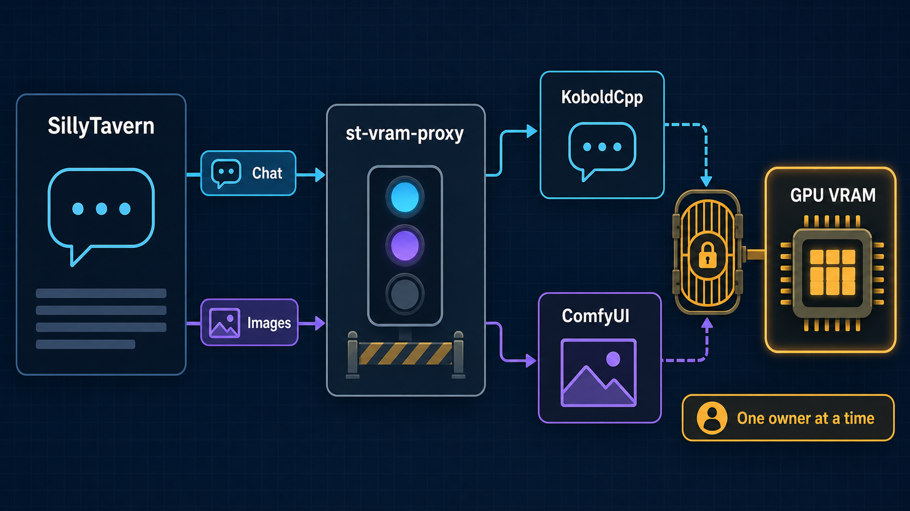
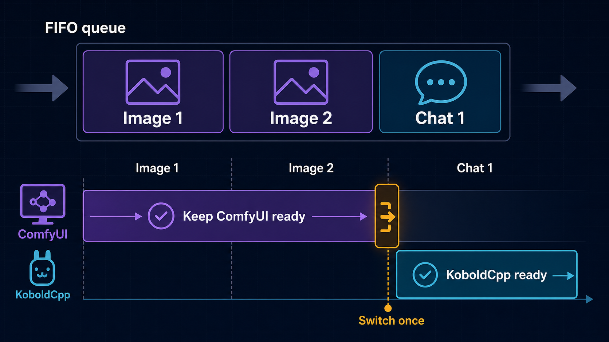

# st-vram-proxy user guide

`st-vram-proxy` lets SillyTavern use a supported LLM backend for chat and
ComfyUI for image generation on a single GPU. It queues requests in arrival
order and ensures that only one backend owns GPU VRAM at a time. KoboldCpp, TabbyAPI (ExLlamaV3), Prism, and
Ollama are currently supported.

This guide covers installation, first-time setup, everyday operation, status
monitoring, and troubleshooting.



## Who this guide is for

Use this guide if:

- SillyTavern, a supported LLM backend, and ComfyUI run on the same computer.
- The LLM and ComfyUI models do not comfortably fit in VRAM
  together.
- You want image and chat requests to wait safely instead of competing for
  memory.

The broker does not install or configure models for you. The LLM backend and
ComfyUI must already work independently before you add the proxy.

## What the proxy does

SillyTavern connects to two proxy ports:

| Workload | SillyTavern connects to | Proxy forwards to |
| --- | --- | --- |
| Chat | `http://127.0.0.1:5001` | Selected LLM backend |
| Images | `http://127.0.0.1:8188` | ComfyUI at `http://127.0.0.1:8189` |

The image URL is also the browser URL for proxied ComfyUI access. The gateway
forwards the interface, uploads, previews, API responses, and live WebSocket
updates without changing GPU ownership. Only a workflow submission requests a
ComfyUI GPU lease.

KoboldCpp startup is passive: the proxy does not contact it or assume GPU
ownership until active work arrives. When an image reaches the front of the
queue, it:

1. Stops starting newer chat requests.
2. Waits for active chats and streams to finish.
3. Asks the LLM adapter to release GPU resources and verifies the result.
4. Sends the image workflow to ComfyUI.
5. Leaves ComfyUI ready for any consecutive image requests.

When a chat reaches the front of the queue, it:

1. Waits for the active image to finish.
2. Asks ComfyUI to unload models and free memory.
3. Restores the previously observed LLM state, or loads KoboldCpp's configured
   `initial_model` once if the proxy has not observed a loaded model yet.
4. Verifies that the original model is ready.
5. Starts the queued chat.

KoboldCpp `GET /api/v1/model` and `GET /v1/models` are passive metadata
exceptions. They never take a chat lease or trigger lifecycle work. While
ComfyUI owns the GPU, the proxy returns a safe inactive response without
contacting KoboldCpp.

If no request is waiting after an image, ComfyUI remains loaded until an active
chat needs the LLM. Idle timers, workflow completion/failure, background health
checks, startup, and shutdown never restore KoboldCpp.



### FIFO examples

| Request order | Result |
| --- | --- |
| Image 1 → Image 2 → Chat 1 | One switch to ComfyUI, both images run, then one switch back to the LLM |
| Image 1 → Chat 1 → Image 2 | Chat 1 runs between the images; Image 2 cannot overtake it |
| Chat 1 → Chat 2 → Image 1 | Both chats may run concurrently; the image waits until both finish |
| Image 1 → no new request | ComfyUI stays ready; no background event restores the LLM |

## Requirements

- Python 3.11 or newer
- KoboldCpp with Model Administration and an Admin/config directory, or Ollama
  with exactly one loaded model
- ComfyUI running in API-compatible mode
- SillyTavern with an API type matching the selected LLM and ComfyUI image generation
- All services listening on the local computer

Keep the proxy and both backend Admin/API ports on loopback
(`127.0.0.1` or `localhost`). Do not expose them directly to an untrusted
network.

## Before installation

Confirm that the backend ports are free and distinct:

| Component | Default role | Default port |
| --- | --- | --- |
| st-vram-proxy chat listener | SillyTavern chat destination | `5001` |
| KoboldCpp | Default real chat backend | `5002` |
| Ollama | Alternative real chat backend | `11434` |
| st-vram-proxy image listener | SillyTavern image destination | `8188` |
| ComfyUI | Real image backend | `8189` |

If you choose different ports, update the backend commands, proxy command, and
SillyTavern settings together.

## Install st-vram-proxy

### Linux

From the repository directory:

```bash
python -m venv .venv
source .venv/bin/activate
python -m pip install -e .
```

After installation, confirm that the command is available:

```bash
st-vram-proxy --help
```

If you open a new terminal later, reactivate the environment:

```bash
source .venv/bin/activate
```

### Windows PowerShell

From the repository directory:

```powershell
py -3.11 -m venv .venv
.\.venv\Scripts\Activate.ps1
python -m pip install -e .
```

Confirm the installation:

```powershell
st-vram-proxy --help
```

If PowerShell blocks activation scripts, either adjust the execution policy for
your user account or run the executable directly:

```powershell
.\.venv\Scripts\st-vram-proxy.exe --help
```

## Configure and start the backends

Start the real backends before starting the proxy.

### 1. Configure KoboldCpp

KoboldCpp must:

- Listen on a port different from the proxy chat port.
- Have Model Administration enabled.
- Have a valid Admin/config directory.
- Expose the `unload_model` and `initial_model` Admin options.
- Start with the model you want restored after image generation.

Linux example:

```bash
./koboldcpp-linux-x64 \
  --model /path/to/model.gguf \
  --host 127.0.0.1 \
  --port 5002 \
  --admin \
  --admindir /path/to/kobold-admin-files
```

On Windows, configure the equivalent fields in the KoboldCpp GUI:

- Host: `127.0.0.1`
- Port: `5002`
- Admin: enabled
- Admin/config directory: a writable directory
- Startup model: the model that should return after ComfyUI finishes

If KoboldCpp Admin is password protected, put the password in the proxy
environment rather than on the command line.

Linux:

```bash
export ST_PROXY_KOBOLD_ADMIN_PASSWORD='replace-me'
```

Windows PowerShell:

```powershell
$env:ST_PROXY_KOBOLD_ADMIN_PASSWORD = 'replace-me'
```

### 2. Alternatively, configure Ollama

Start Ollama and preload exactly one model:

```bash
ollama serve
ollama run gemma3 ""
```

Verify `ollama ps` shows exactly one model. The proxy uses Ollama's lifecycle
API to unload that model before ComfyUI work and reload it indefinitely when
chat returns.

### 3. Start ComfyUI

Linux example:

```bash
python main.py --listen 127.0.0.1 --port 8189
```

Windows portable example:

```powershell
.\python_embeded\python.exe ComfyUI\main.py --listen 127.0.0.1 --port 8189
```

Confirm that ComfyUI opens normally and that your intended SillyTavern workflow
can generate an image before introducing the proxy.

## Start the proxy

With the virtual environment active:

```bash
st-vram-proxy \
  --llm-backend koboldcpp \
  --llm-url http://127.0.0.1:5002 \
  --comfy-url http://127.0.0.1:8189 \
  --chat-port 5001 \
  --image-port 8188
```

Windows PowerShell uses the same options:

```powershell
st-vram-proxy `
  --llm-backend koboldcpp `
  --llm-url http://127.0.0.1:5002 `
  --comfy-url http://127.0.0.1:8189 `
  --chat-port 5001 `
  --image-port 8188
```

At KoboldCpp startup, the proxy opens the two listener ports without contacting
KoboldCpp or changing GPU ownership. The first active chat or workflow performs
the required lifecycle validation. `--check-backend` remains available for an
explicit operator-requested readiness check.

A healthy startup ends with a log similar to:

```text
broker ready: chat=http://127.0.0.1:5001 image=http://127.0.0.1:8188 state=awaiting_request
```

Leave this terminal running. Press `Ctrl+C` to stop the proxy cleanly. Shutdown
does not restore KoboldCpp. `--restore-llm-on-idle` is retained only as a
deprecated compatibility flag and has no effect; only an active LLM request can
start a restore.

## Configure SillyTavern

### Chat connection

1. Open SillyTavern's API Connections panel.
2. Select the API type matching the configured backend.
3. Set the server URL to `http://127.0.0.1:5001`.
4. Connect normally.

### Image connection

1. Open the Image Generation extension settings.
2. Select ComfyUI.
3. Set the ComfyUI server URL to `http://127.0.0.1:8188`.
4. Select or configure the workflow you normally use.

SillyTavern should point to the proxy ports, not directly to the real LLM or
ComfyUI ports.

## Verify the setup

### 1. Check broker status

Linux:

```bash
curl http://127.0.0.1:5001/broker/status
```

Windows PowerShell:

```powershell
Invoke-RestMethod http://127.0.0.1:5001/broker/status
```

Immediately after startup, expect:

```json
{
  "responding": true,
  "ready": true,
  "state": "awaiting_request",
  "state_stalled": false,
  "healthy": true,
  "dispatcher_alive": true,
  "recovering": false,
  "recovery_attempts": 0,
  "recovery_retry_seconds": null,
  "gpu_owner": null,
  "active_chats": 0,
  "active_llm_metadata": 0,
  "active_comfy_controls": 0,
  "waiting_chats": 0,
  "waiting_images": 0,
  "queued_workflow_bytes": 0,
  "active_prompt_id": null,
  "last_error": null,
  "chat_available": true,
  "llm_backend": "koboldcpp",
  "idle_restore_enabled": false,
  "comfy_route_policy": "transparent"
}
```

The status endpoint works on either proxy port.

### 2. Test chat

Send a short SillyTavern chat message. The first active request performs any
required ComfyUI cleanup and KoboldCpp discovery/load, then reaches `llm_ready`.

### 3. Test image generation

Request one image. During the handoff, the state progresses through:

```text
draining_llm → unloading_llm → image_active → comfy_ready
```

After the image finishes, `gpu_owner` remains `comfy`. This is intentional.

### 4. Test the return to chat

Send another chat message. The state progresses through:

```text
cleaning_comfy → reloading_llm → llm_ready
```

The chat starts after the original LLM model is verified.

## Understand the status endpoint

### Status fields

| Field | Meaning |
| --- | --- |
| `responding` | The status API is serving this response |
| `ready` | Whether coordinated GPU work can currently be accepted safely |
| `state` | Current handoff or processing stage |
| `state_age_seconds` | Seconds spent in the current coordinator state |
| `state_stalled` | Whether the state exceeded its operation-specific deadline |
| `healthy` | Coordinator, dispatcher, ownership, and state-age watchdog result |
| `dispatcher_alive` | Whether the FIFO dispatcher task is running |
| `recovering` | Whether a waiting active LLM request is currently restoring ownership |
| `recovery_attempts` | Active-request restore attempts made by this coordinator |
| `recovery_retry_seconds` | Always `null`; background recovery is disabled |
| `gpu_owner` | `llm`, `comfy`, or `null` while ownership is being changed or is unknown |
| `active_chats` | Chat requests currently using the selected LLM |
| `active_llm_metadata` | Passive KoboldCpp metadata reads currently protected from workflow handoff |
| `active_comfy_controls` | Cancellation/control requests currently using the ComfyUI control plane |
| `waiting_chats` | Chat requests still waiting in the FIFO queue |
| `waiting_images` | Image requests still waiting in the FIFO queue |
| `queued_workflow_bytes` | Request-body bytes retained by queued workflows |
| `max_queued_images` | Configured queued-workflow count limit |
| `max_queued_workflow_bytes` | Configured queued-workflow memory limit |
| `active_prompt_id` | ComfyUI prompt currently being monitored, or `null` |
| `last_error` | Most recent controlled error or warning |
| `chat_available` | Whether the broker can accept chat requests; `true` does not mean the LLM is already loaded |
| `llm_backend` | Selected lifecycle adapter, such as `koboldcpp` or `ollama` |
| `idle_timeout` | Configured ComfyUI idle period in seconds |
| `idle_restore_enabled` | Always `false`; proactive LLM restoration is disabled |
| `idle_restore_scheduled` | Always `false`; no idle restore is scheduled |
| `comfy_route_policy` | `transparent` by default, or `strict` when unclassified mutations are rejected |
| `active_chat_requests` | Downstream chat HTTP requests currently open |
| `active_image_requests` | Downstream non-WebSocket ComfyUI requests currently open |
| `active_websockets` | ComfyUI WebSockets currently relayed |
| `control_connection_limit` | Connection cap for lifecycle and coordinated control calls |
| `chat_connection_limit` | Connection cap for LLM chat traffic |
| `image_connection_limit` | Connection cap for ordinary ComfyUI HTTP traffic |
| `websocket_connection_limit` | Connection cap for ComfyUI WebSockets |

`waiting_chats` and `waiting_images` count queued work. The request currently
being activated or processed is not included in those counters.

### States

| State | Meaning |
| --- | --- |
| `initializing` | Coordinator is starting |
| `awaiting_request` | KoboldCpp startup is passive and no GPU owner has been assumed |
| `cleaning_comfy` | Proxy is asking ComfyUI to free models and memory |
| `verifying_llm` | Proxy is checking an LLM model before treating it as ready |
| `llm_ready` | The selected LLM owns the GPU and chat can start |
| `draining_llm` | Newer work is queued while active chats finish |
| `unloading_llm` | The LLM adapter is releasing GPU resources |
| `comfy_ready` | ComfyUI owns the GPU and is idle between image jobs |
| `image_active` | A ComfyUI prompt is running |
| `reloading_llm` | A waiting active LLM request is restoring the observed model state |
| `error` | GPU ownership or backend readiness could not be verified |
| `shutting_down` | Proxy is stopping without loading or restoring KoboldCpp |

## Everyday operation

- Start the selected LLM backend and ComfyUI before the proxy.
- Keep the proxy running while SillyTavern is in use.
- A chat waiting behind images is normal.
- An image waiting for a streaming chat is normal.
- Consecutive images reuse the ComfyUI ownership period.
- After 60 seconds without active or queued work, ComfyUI is freed and the
  selected LLM is restored and verified.
- Consecutive chats can run concurrently until an image reaches the front of
  the queue.
- Stop the proxy with `Ctrl+C` so it can restore the LLM safely.
- Use `/broker/status` before restarting backends during a handoff.

## Configuration reference

Every command-line option has an `ST_PROXY_...` environment equivalent.
Command-line values override only their corresponding defaults supplied by the
environment.

| Command-line option | Environment variable | Default | Purpose |
| --- | --- | --- | --- |
| `--listen-host` | `ST_PROXY_LISTEN_HOST` | `127.0.0.1` | Address used by both proxy listeners |
| `--chat-port` | `ST_PROXY_CHAT_PORT` | `5001` | SillyTavern chat destination |
| `--image-port` | `ST_PROXY_IMAGE_PORT` | `8188` | SillyTavern image destination |
| `--llm-backend` | `ST_PROXY_LLM_BACKEND` | `koboldcpp` | LLM lifecycle adapter |
| `--llm-url` | `ST_PROXY_LLM_URL` | backend-specific | Real LLM origin |
| `--comfy-url` | `ST_PROXY_COMFY_URL` | `http://127.0.0.1:8189` | Real ComfyUI origin |
| `--sc117-url` | `ST_PROXY_SC117_URL` | `http://127.0.0.1:48640` | SC117 origin in all mode |
| `--orca-url` | `ST_PROXY_ORCA_URL` | `http://127.0.0.1:48642` | Orca origin in all mode |
| `--prism-model` | `ST_PROXY_PRISM_MODEL` | `prism-bonsai-2-27b-abliterated` | Default Prism preset when model is omitted |
| `--tabby-model` | `ST_PROXY_TABBY_MODEL` | unset | Native model name for a cold TabbyAPI load |
| `--tabby-max-seq-len` | `ST_PROXY_TABBY_MAX_SEQ_LEN` | `32768` | Fallback context for the first TabbyAPI load; model profiles override |
| `--kobold-admin-password` | `ST_PROXY_KOBOLD_ADMIN_PASSWORD` | unset | KoboldCpp Admin bearer password |
| `--connect-timeout` | `ST_PROXY_CONNECT_TIMEOUT` | `30` seconds | Maximum pool-acquisition and socket-connect wait |
| `--request-timeout` | `ST_PROXY_REQUEST_TIMEOUT` | `3900` seconds | Maximum idle wait between upstream response bytes |
| `--image-timeout` | `ST_PROXY_IMAGE_TIMEOUT` | `1800` seconds | Maximum monitored image-job duration |
| `--chat-drain-timeout` | `ST_PROXY_CHAT_DRAIN_TIMEOUT` | `3900` seconds | Maximum wait for active chats to finish |
| `--unload-timeout` | `ST_PROXY_UNLOAD_TIMEOUT` | `180` seconds | Maximum LLM release/verification time |
| `--reload-timeout` | `ST_PROXY_RELOAD_TIMEOUT` | `600` seconds | Maximum LLM restore/verification time |
| `--cleanup-timeout` | `ST_PROXY_CLEANUP_TIMEOUT` | `60` seconds | Maximum ComfyUI cleanup time |
| `--idle-timeout` | `ST_PROXY_IDLE_TIMEOUT` | `60` seconds | Deprecated compatibility setting; no restore timer is scheduled |
| `--restore-llm-on-idle` | `ST_PROXY_RESTORE_LLM_ON_IDLE` | disabled | Deprecated compatibility flag; automatic restore remains disabled |
| `--poll-interval` | `ST_PROXY_POLL_INTERVAL` | `0.5` seconds | Backend state polling interval |
| `--comfy-poll-failure-limit` | `ST_PROXY_COMFY_POLL_FAILURE_LIMIT` | `6` | Consecutive failed history polls before abort |
| `--max-workflow-body-bytes` | `ST_PROXY_MAX_WORKFLOW_BODY_BYTES` | `67108864` | Maximum `/prompt` request-body size |
| `--max-queued-images` | `ST_PROXY_MAX_QUEUED_IMAGES` | `32` | Maximum workflows waiting in the FIFO |
| `--max-queued-workflow-bytes` | `ST_PROXY_MAX_QUEUED_WORKFLOW_BYTES` | `268435456` | Maximum request-body bytes retained by waiting workflows |
| `--strict-comfy-routes` | `ST_PROXY_STRICT_COMFY_ROUTES` | disabled | Reject unclassified mutating custom-node routes |
| `--check-backend` | — | disabled | Check LLM control and readiness, then exit |
| `--backend-check-timeout` | `ST_PROXY_BACKEND_CHECK_TIMEOUT` | `2` seconds | Readiness-command timeout |
| `--log-level` | `ST_PROXY_LOG_LEVEL` | `INFO` | Python logging level |

KoboldCpp defaults to `http://127.0.0.1:5002`; Ollama defaults to
`http://127.0.0.1:11434`. `--kobold-url` and `ST_PROXY_KOBOLD_URL` remain
compatibility aliases for the generic LLM origin.

Example environment-only configuration on Linux:

```bash
export ST_PROXY_LLM_BACKEND=koboldcpp
export ST_PROXY_LLM_URL=http://127.0.0.1:5002
export ST_PROXY_COMFY_URL=http://127.0.0.1:8189
export ST_PROXY_CHAT_PORT=5001
export ST_PROXY_IMAGE_PORT=8188
st-vram-proxy
```

## Troubleshooting

Start with two pieces of information:

```bash
curl http://127.0.0.1:5001/broker/status
```

Then read the proxy terminal around the most recent state transition. Logs do
not include prompts, generated content, request bodies, model names,
authorization values, or the Admin password.

### A chat or image appears to be waiting

Check:

- `state`
- `active_chats`
- `waiting_chats`
- `waiting_images`
- `active_prompt_id`

Waiting is expected when an earlier request owns the GPU. FIFO ordering means a
newer request never jumps ahead merely because its backend is already loaded.

If `active_chats` remains nonzero, a long-running or disconnected stream may
still be draining upstream. The proxy deliberately waits for upstream
generation to finish before asking the LLM adapter to release the GPU. A stream
that stops producing bytes is terminated after `--request-timeout` instead of
holding its lease indefinitely.

If `healthy` is false, inspect `state_stalled`, `state_age_seconds`,
`dispatcher_alive`, active request counts, and `last_error`. The optional stack
supervisor logs the degraded state but keeps the proxy and the rest of the
stack running. Only an explicit shutdown such as `Ctrl+C`, `SIGTERM`, `SIGHUP`,
or `./st-stack.zsh --stop` stops the supervised proxy.

### Startup reports Model Administration errors

Typical messages mention:

- `model administration check failed`
- `admin options check failed`
- required options missing
- Admin request rejected

Verify:

1. KoboldCpp Admin mode is enabled.
2. `--admindir` or the GUI Admin/config directory is valid.
3. The Admin password matches `ST_PROXY_KOBOLD_ADMIN_PASSWORD`.
4. KoboldCpp exposes both `unload_model` and `initial_model`.
5. You restarted KoboldCpp after changing its Admin configuration.

This section applies only to the `koboldcpp` adapter.

### Ollama startup reports a ready-state snapshot error

The `ollama` adapter requires exactly one model in `/api/ps`. Run:

```bash
ollama ps
```

Load the intended model if none is present, or stop extra models before
restarting the proxy. The proxy deliberately refuses to guess which of several
models should be restored.

### Status remains `error`

The proxy fails closed when it cannot verify GPU ownership. Read `last_error`,
fix the backend problem, and send a new active LLM request when you want one
coordinated recovery attempt. The proxy performs no background load or retry.
Do not bypass the proxy and send work directly to both backends while ownership
is uncertain.

### KoboldCpp unload times out

Symptoms include `confirmation of unloaded failed: timed out`.

Verify that:

- The Admin operation succeeds in KoboldCpp.
- `/api/v1/model` reports an inactive state after unload.
- KoboldCpp is responsive on the configured upstream port.
- The configured `--unload-timeout` is long enough for your system.

### KoboldCpp reload times out

Symptoms include `confirmation of loaded failed: timed out`.

After the proxy has observed a loaded model, later reloads must match it. Check
that:

- `initial_model` points to the intended startup model.
- The model file is still available.
- KoboldCpp has enough memory after ComfyUI cleanup.
- The configured `--reload-timeout` is long enough.

### ComfyUI image job times out

The proxy asks ComfyUI to interrupt the job and records the error. It leaves
ComfyUI as GPU owner and does not contact or restore KoboldCpp.

Check the ComfyUI console for workflow or node errors. Increase
`--image-timeout` only if the workflow is healthy but legitimately takes
longer.

### ComfyUI cleanup fails

The proxy records the cleanup failure and does not reload the LLM because GPU
release is unconfirmed. Check ComfyUI's `/free` support and console output. The
broker stays online in `error`, returns HTTP 503 for coordinated GPU work, and
does not retry in the background. A later active LLM request can retry cleanup
once; after cleanup and the exact LLM restore succeed, normal dispatch resumes
in the same proxy process.

### HTTP 502 versus HTTP 503

| Response | Meaning |
| --- | --- |
| HTTP 413 | A workflow request body exceeded its configured byte limit |
| HTTP 429 | The bounded workflow queue reached its count or memory limit |
| HTTP 502 | A normal proxied request to the selected backend failed |
| HTTP 503 | The broker rejected work because shutdown, initialization, or GPU ownership was not safely resolved |

### Port already in use

Choose four distinct ports or stop the process using the conflicting port.
Remember that SillyTavern uses the proxy ports while the proxy uses the backend
ports.

On Linux, inspect a port with:

```bash
ss -ltnp | grep ':5001'
```

On Windows PowerShell:

```powershell
Get-NetTCPConnection -LocalPort 5001
```

### SillyTavern bypasses the proxy

Recheck both SillyTavern URLs:

- Chat must use the proxy chat port.
- Images must use the proxy image port.

Do not configure SillyTavern with the real LLM or ComfyUI ports.

### A custom-node web action gets HTTP 403

The default transparent policy forwards new custom-node web routes without a
central allowlist. If you explicitly started the proxy with
`--strict-comfy-routes` or `ST_PROXY_STRICT_COMFY_ROUTES=true`, unclassified
mutations receive HTTP 403; disable strict mode or add a reviewed
classification.

Reviewed release and model-unload buttons work only while ComfyUI owns the GPU.
Helto Director's prompt-optimizer execution routes remain blocked because they
can start GPU work outside the normal workflow queue. That block applies in
both transparent and strict modes and cannot be bypassed with the legacy
`--allow-unknown-comfy-routes` compatibility option.

An unknown custom route is forwarded without acquiring a GPU lease. If a newly
installed node starts CUDA work through such a route instead of `/prompt`, add
that route to the GPU-sensitive policy before using it alongside the LLM.

## Security and privacy

- Loopback is the safe default.
- Do not expose an LLM lifecycle or Admin API publicly.
- Do not expose ComfyUI or the proxy directly to an untrusted network.
- Store the Admin password in `ST_PROXY_KOBOLD_ADMIN_PASSWORD`.
- Avoid putting passwords on command lines where shell history or process
  listings may reveal them.
- Upstream URLs containing embedded credentials are rejected.
- Request bodies, prompts, generated content, model names, and authorization
  headers are not logged.
- For a hard single-ingress boundary, place the real backends on an internal
  container/network-namespace network and expose only the broker listeners.
- The broker coordinates VRAM lifecycle APIs; it does not revoke CUDA device
  access at the operating-system level.

## Optional local stack supervisor

The repository includes `st-stack.zsh`, a Linux/Zsh supervisor tailored to the
repository owner's local multi-service setup. It can supervise a configured
LLM, or all five engines, and the proxy. It does not manage PocketTTS,
SillyTavern, AllTalk, or ComfyUI.

This script is not a portable default installation:

- Its non-LLM application directories remain constants near the top of the
  script and must match your computer.
- Configure the LLM with `ST_PROXY_LLM_BACKEND`, `ST_PROXY_LLM_URL`, and
  `ST_STACK_LLM_DIR`.
- When using KoboldCpp without `ST_STACK_LLM_COMMAND`, the supervisor scans
  `ST_STACK_KOBOLD_CONFIG_DIR` recursively for `.kcpps` files. The config
  directory defaults to `models` beneath `ST_STACK_LLM_DIR`.
- Its default port layout differs from the standalone examples in this guide:
  its KoboldCpp profile expects the real LLM and ComfyUI origins on `5001` and `8188`, and
  exposes the proxy on `5002` and `8189`.
- It requires Zsh and Linux process-management tools.

After adapting it to your environment:

```bash
./st-stack.zsh
```

Choose **1) KoboldCpp**, **2) TabbyAPI**, **3) Prism**, **4) Qwen SC117**,
or **5) Qwen Orca** for a single engine. Press **Enter** to start all five; see
[all-backend mode](#all-backend-mode).

The interactive KoboldCpp list displays paths relative to `models` and omits
the `.kcpps` extension. It does not offer or enable automatic idle restoration.
To select a config without prompts, set its relative path with or without the
extension:

```bash
export ST_STACK_KOBOLD_CONFIG='roleplay/gemma4/role-play-no-thinking-goetia-26b'
./st-stack.zsh
```

`ST_STACK_KOBOLD_EXECUTABLE` changes the KoboldCpp executable and defaults to
`./koboldcpp-linux-x64`. Setting `ST_STACK_LLM_COMMAND` preserves the generic
custom-command behavior and takes precedence over automatic KoboldCpp config
selection.

The standard KoboldCpp launch enables native Router mode with a temporary
CPU-only configuration that loads no model. The selection at startup remains
the default profile for the first active request (`initial_model`, or an omitted
model in single-backend mode), while all discovered `.kcpps` files become
available through the proxy's `/v1/models`. Choose one of those exact IDs in your
client; KoboldCpp performs the model switch inside the proxy's GPU lease.
One model-dependent request runs at a time, and ComfyUI waits for its complete
response and confirmed model unload. The model list remains available from
cache while ComfyUI works.

Temporary admin links preserve deep directory layouts without changing the
source profiles. Their names contain a stable suffix to distinguish identical
filenames in different directories. Restart the stack after adding profiles.
An already running KoboldCpp must be restarted with Router mode enabled before
the new stack mode can use it. Set `ST_PROXY_KOBOLD_ROUTER_MODE=false` to keep
the previous single-profile behavior. Custom `ST_STACK_LLM_COMMAND` launches
remain in that mode unless Router mode is explicitly enabled and configured in
the custom command. See [native Router mode](../README.md#koboldcpp-native-router-mode)
for standalone setup, transport limits and supported requests.

Show child-process output:

```bash
./st-stack.zsh --log
```

The proxy's own log is always shown, including without `--log`. Backend HTTP
errors are logged at `ERROR` as soon as response headers arrive; connection,
timeout and lifecycle failures are also logged at `ERROR` for every LLM backend.
Raw backend bodies, tracebacks, credentials and prompts are not logged.
`--log` additionally shows the underlying services' own output.

Stop the supervised stack:

```bash
./st-stack.zsh --stop
```

Do not use the supervisor until you have reviewed its configured directories,
commands, ports, and shutdown behavior.

## Quick reference

Start order:

```text
1. Selected LLM backend
2. ComfyUI
3. st-vram-proxy
4. SillyTavern connection
```

Default URLs:

```text
SillyTavern chat:   http://127.0.0.1:5001
Default LLM backend: http://127.0.0.1:5002
SillyTavern images: http://127.0.0.1:8188
ComfyUI backend:    http://127.0.0.1:8189
Broker status:      http://127.0.0.1:5001/broker/status
```

Healthy idle states:

```text
llm_ready   — the selected LLM owns the GPU
comfy_ready — ComfyUI owns the GPU until an active LLM request needs it
```

Safe stop:

```text
Press Ctrl+C in the proxy terminal.
```

## All-backend mode

Press Enter at the stack's backend menu, or run:

```bash
ST_PROXY_LLM_BACKEND=all ./st-stack.zsh
```

The stack starts and supervises KoboldCpp, TabbyAPI, Prism, Qwen SC117 and Qwen Orca
with independent process groups. Ctrl-C and `--stop` stop all five and the proxy.
Choices 1–5 select one backend. ComfyUI remains separately managed.

Connect the client to `http://127.0.0.1:5002/v1`. `/v1/models` combines
KoboldCpp's native router profiles, TabbyAPI's `/v1/model/list`, Prism's
native router presets, and each Strata server's `/v1/models`. It does not scan
model files or guess compatible
formats. IDs are namespaced, for example `koboldcpp/example.kcpps`,
`tabbyapi/example-exl3`, `prism/example-preset`, `sc117/model` and `orca/model`.
Use the exact returned ID
in each model-dependent request; there is no implicit engine when `model` is
missing. The prefix is removed before forwarding to the native API. Responses,
including SSE and reasoning content, retain the native format.

Discovery is passive, including while ComfyUI runs. An unavailable catalog
returns an upstream error instead of presenting an incomplete list as complete.
Native listing permissions still apply; TabbyAPI must expose its full catalog
to the proxy's existing local control connection. Listed models can still fail
to load if their configuration or available VRAM is insufficient.

All active model requests share the ComfyUI FIFO. Before switching engines,
the current response drains, the old engine confirms release, and only then
does the selected engine load or reserve its requested model. Same-model
requests reuse the loaded model. TabbyAPI's observed load parameters are saved
per model; unseen models use its native load defaults and model-local profiles.
Its existing reasoning-effort translation is also preserved. A failed or
unconfirmed load/unload blocks handoff to another engine or ComfyUI.
ComfyUI queue and memory-settling checks also apply in all mode. No idle timer,
catalog read or completed workflow restores a model in the background.

KoboldCpp starts without a model in Router mode and exposes the configured
`.kcpps` profiles. `ST_STACK_KOBOLD_CONFIG` selects the profile behind
`koboldcpp/initial_model`; when unset, all mode uses the first discovered profile
without another prompt. It loads only when an active request selects it.
The source profiles are unchanged. TabbyAPI starts with
empty `--model-name` and `--embedding-model-name` overrides so it does not
compete for VRAM at startup; its configuration file is unchanged. Prism keeps
its existing router requirements: `--models-max 1`, `--no-models-autoload`, and
`load-on-startup = false`. Already running services are reused and their
model state is reconciled on the first active proxy request.

For all mode, upstream origins are configured with `ST_PROXY_LLM_URL`
(KoboldCpp, stack default `http://127.0.0.1:5001`), `ST_PROXY_TABBY_URL`
(`http://127.0.0.1:5003`), `ST_PROXY_PRISM_URL`
(`http://127.0.0.1:5006`), `ST_PROXY_SC117_URL` (`http://127.0.0.1:48640`),
and `ST_PROXY_ORCA_URL` (`http://127.0.0.1:48642`).
Optional per-engine launcher overrides are
`ST_STACK_KOBOLDCPP_DIR` / `ST_STACK_KOBOLDCPP_COMMAND`,
`ST_STACK_TABBYAPI_DIR` / `ST_STACK_TABBYAPI_COMMAND`,
`ST_STACK_PRISM_DIR` / `ST_STACK_PRISM_COMMAND`,
`ST_STACK_SC117_DIR` / `ST_STACK_SC117_COMMAND`, and
`ST_STACK_ORCA_DIR` / `ST_STACK_ORCA_COMMAND`. Custom commands must preserve
the corresponding native lifecycle contract and accept the Tabby startup
overrides. The generic `ST_STACK_LLM_DIR` and `ST_STACK_LLM_COMMAND` remain
single-engine settings.

To start only the proxy against existing services, use `--llm-backend all`,
`--llm-url`, `--tabby-url`, `--prism-url`, `--sc117-url` and `--orca-url`.
Set listener ports explicitly when
using the stack port layout. `/broker/status` includes `active_llm_backend`
and the namespaced `active_model`; `llm_reserved` denotes the shared reservation,
including native KoboldCpp inline loading. Lifecycle/admin routes and
`reload` / `autoload` query overrides cannot bypass that reservation.

## TabbyAPI / ExLlamaV3

Choose TabbyAPI in the stack's first menu, or set `ST_PROXY_LLM_BACKEND=tabbyapi`.
Enter starts all five engines. `--stop` skips the menu and remembers the supervised
backend choice. The existing KoboldCpp configuration selection and Router mode
are unchanged. Ollama remains available through its existing environment setting.

TabbyAPI's default directory is `~/git/tabby`, command is `./start.sh`, and origin
is `http://127.0.0.1:5003`. The stack does not rewrite TabbyAPI configuration.
Configure its existing server/model settings for your model directory and keep
authentication disabled. No keys or new authorization mechanism are introduced.
Keep native model settings stable for the duration of a proxy run.

Example for the requested model (these settings do not edit TabbyAPI files):

```sh
export ST_PROXY_LLM_BACKEND=tabbyapi
export ST_PROXY_TABBY_MODEL=G4-MeroMero-26B-A4B-exl3-3.10bpw
export ST_PROXY_TABBY_MAX_SEQ_LEN=32768
./st-stack.zsh
```

The native TabbyAPI configuration must point at `/home/thhel/models` for that
installation. A server that already has a model loaded supplies its own context
and cache settings. A server without a model uses `--tabby-model` on the first active
LLM request, with `--tabby-max-seq-len` as a fallback that Tabby's model-local
configuration can override. For direct proxy startup, use `--llm-backend tabbyapi`,
`--tabby-model NAME`, and optionally `--tabby-max-seq-len TOKENS`.

For different context limits per model, set these fields in each model folder's
`tabby_config.yml`, alongside its existing reasoning and vision settings:

```yaml
model:
  max_seq_len: 16384
  cache_size: 16384
```

For example, one model can use 16384 while another uses 32768. Model-local values
override API load requests. The proxy adopts the settings reported after the first
load and preserves each selected model's actual settings across GPU handoffs.

Initialization and `--check-backend` are passive for TabbyAPI. The latter checks
service health, model listing, and observed model state; it does not load or
unload a model and cannot prove physical GPU release. Client `GET` and `HEAD`
requests to `/v1/models`, `/v1/model/list`, and `/health` are forwarded to TabbyAPI
regardless of GPU ownership, including before the first active request and while
ComfyUI owns the GPU. TabbyAPI's responses and authorization rules are preserved;
these requests never load a model or trigger a GPU handoff. Reads of `/v1/model`
and `/props` also never acquire GPU ownership, but return 503 while the LLM is not
the verified owner. Use `/broker/status` to observe the proxy's state independently
of TabbyAPI service health or model readiness.

Model names, messages, sampling fields, total output limits, and response streams
pass through unchanged. Thinking controls receive the small compatibility mapping
described below. Model selection remains native to TabbyAPI. The adapter
captures the currently loaded model again before unload, preserving the latest
native selection without introducing proxy model routing. As with existing
passthrough backends, direct lifecycle operations and out-of-band calls are
outside coordinated ownership; do not load models alongside ComfyUI work.

The adapter saves reported context, cache size/mode, chunk size, and vision use.
It reloads explicitly, consumes the complete load SSE response, and verifies the
model and saved settings before granting a chat lease. TabbyAPI may emit a
`finished` component event before generator initialization completes; that event
alone is insufficient. The normal shared FIFO, response drain, cancellation,
ComfyUI cleanup, and request-driven restoration policies are retained.

TabbyAPI's load API and model card do not expose every native setting. CPU MoE
settings (`cpu_moe_offload_layers`, `cpu_moe_split_experts`, `cpu_moe_threads`),
`vision_offload`, batch limits, and other unreported settings must be preserved
using TabbyAPI's existing `model.use_as_default` or model-local settings. In
particular, startup-only settings are not automatically defaults for API loads.
Model-local `tabby_config.yml` overrides take precedence over API load values;
reported settings that differ from a saved restore point after reload cause an error.
If you change a profile, reload that model in Tabby while ComfyUI is idle so the
proxy can capture the new settings before its next handoff. Prompt templates and
reasoning generation remain TabbyAPI responsibilities; the proxy only adapts
request controls as described below.

A lifecycle failure leaves GPU ownership unconfirmed, but does not permanently
disable status observation. Recovery is driven only by the next active request:

- A structured load error followed by a clean end of the SSE response confirms
  that the load attempt ended. If `/v1/model` confirms no model is loaded, the
  next active LLM request may make one new load attempt after ComfyUI cleanup.
  Repeated failures return errors; there is no background retry loop. The saved
  model and settings are retained. A failed load alone does not grant ComfyUI a
  lease because partial allocations may remain.
- Explicit CUDA out-of-memory and insufficient-VRAM load errors are immediately
  logged as `insufficient_vram`. After the load stream ends cleanly, the failed
  request and broker status report that the model is not ready because there is
  not enough GPU memory for the model/cache. The next active LLM request tries
  loading again with the saved settings, allowing recovery after you free memory.
  No retry occurs within the failed request or from passive metadata polling.
  A memory-error event without a clean stream end remains unconfirmed, as below.
- A timeout, broken stream, or malformed response does not confirm that loading
  ended. TabbyAPI continues loading after a client disconnects. A later “no model”
  response remains ambiguous and cannot authorize another load. If a subsequent
  observation finds the expected model and saved settings ready, normal handoffs
  resume without restarting the proxy or loading the model again.
- An unconfirmed unload can be reconciled when `/v1/model` confirms it is unloaded.
  Unreachable services and mismatched model/settings remain blocked.

The proxy does not restart services or unload other GPU processes. An ambiguous
load that never becomes ready still requires backend investigation. Ordinary
ComfyUI cleanup failures retain the retry-on-next-active-request behavior.

ComfyUI's `/free` response acknowledges a cleanup request, not completed GPU
memory release. All backends retain the five-second minimum wait after a
successful response. For TabbyAPI, the proxy also waits for `/queue` to be idle
before requesting cleanup, then requires an idle queue and two consecutive equal
memory observations from `/system_stats`. These checks share the existing cleanup
timeout; unavailable or invalid status prevents LLM loading. ComfyUI's reported
free VRAM includes reclaimable Torch cache, so observations also account for
driver-free memory separately. Stable values are a settling check, not proof that
every model has been unloaded or that the next model will fit alongside other
GPU processes. Queue contents and raw memory responses are not logged.

### Thinking controls for TabbyAPI chat

Only `POST /v1/chat/completions` receives this mapping. KoboldCpp (including
Router mode) retains its existing payload handling. Tabby chat bodies use the
existing `--max-chat-body-bytes` limit (32 MiB by default), including chunked
requests, before forwarding through the same chat lease and streaming transport.

For a positive request output limit `M`, the effective `reasoning_effort` maps to:

| Effort | Added `reasoning_budget_tokens` |
| --- | --- |
| `minimal` | `floor(M / 10)` |
| `low` | `floor(M / 4)` |
| `medium` | `floor(M / 2)` |
| `high`, unset, or unknown | No calculated budget |
| `none` / `off` | Disable thinking when no explicit thinking toggle is supplied |

`M` follows Tabby's first-present alias order: `max_tokens`,
`max_completion_tokens`, then `max_length`. The total output limit is preserved;
reasoning consumes part of that limit. No tokens are added or subtracted. Without
a positive integer request limit, the proxy forwards the effort without inventing
a budget or rejecting the request. It does not infer server sampler defaults,
forced overrides, or available context length. Tiny limits can round down to zero;
a zero budget ends reasoning as it starts and is distinct from disabling thinking.

Native explicit budget fields retain Tabby's first-present alias order:
`reasoning_budget_tokens`, `reasoning_budget`, `thinking_budget`, then
`thinking_token_budget`. A nonnegative native budget, including zero, wins over
`reasoning.max_tokens`, the Kobold compatibility field `thinking_budget_tokens`,
and a calculated level. A null or negative native budget still falls back to
`reasoning.max_tokens`; lower-priority aliases remain ignored. When neither native
source supplies a budget, `thinking_budget_tokens` is renamed to
`reasoning_budget_tokens` and takes precedence over level calculation. Explicit
null/negative budgets without that compatibility field are left intact for Tabby's
server fallback, rather than replaced by a percentage. Invalid native values are
left for Tabby's validator. This explicit-budget-first policy intentionally differs
from KoboldCpp's level-first policy.

Effort and thinking toggles follow Tabby's request priority: the `reasoning`
object, then non-null flat fields, then `template_vars` (or its lower-priority
alias `chat_template_kwargs`). An explicit toggle is preserved even if it conflicts
with `none`/`off`; otherwise these levels add `enable_thinking=false`. Disabled
thinking does not receive a calculated budget. No message content is inspected.

**High/Unset requires Tabby's model-level default reasoning budget to be disabled
(`reasoning_budget_tokens: null` or negative).** The proxy does not clear or replace
that default. Actual Tabby configuration has not been inspected or changed.
Server `template_vars_force` can override request controls; effective runtime
behavior still depends on the template and backend.

Tabby ignores reasoning-budget injection when structured generation uses a JSON
schema, regex, or grammar. These fields and `response_format` are preserved, so
the mapping does not bypass that restriction. A schema written only in message
text does not count as a native constraint. A compatible reasoning format and
backend support for `constrain_output_now` are also required. Injection is an
approximate threshold and may overshoot with batching/speculative generation;
it is not a guarantee of exact Kobold token behavior.

Source contract checked against local TabbyAPI `de76ff8` (chat request aliases,
template variable resolution, reasoning-budget injection, and ExLlamaV3 output
limits). Automated tests use synthetic HTTP backends and prove request mapping,
stream draining, and handoff ordering, not actual reasoning output or GPU behavior.

### Separate live acceptance test

After explicitly authorizing live GPU work, use synthetic chat and workflow
inputs to exercise LLM → ComfyUI → LLM. Measure actual VRAM release after unload,
verify that no generation overlaps the handoff, and check restored model,
32768-token context, cache and native offload settings. Repeat with a disconnected
stream. Fake-backend tests verify HTTP/lifecycle ordering only; they do not
establish physical GPU release or the installed model configuration.

For thinking acceptance, compare Minimal/Low/Medium/High/Unset/Off with the same
positive output limit, both streaming and non-streaming. Confirm explicit budget
precedence, disabled server defaults, and behavior with native schema/grammar
constraints. Check thinking toggles with the installed template and verify that
the installed ExLlamaV3 backend can enforce reasoning-budget injection.

## Prism / Ternary Bonsai

Choose **3) Prism** in `st-stack.zsh`, or skip the menu with:

```bash
ST_PROXY_LLM_BACKEND=prism ./st-stack.zsh
```

The stack starts `~/git/prism/start.sh` as a normal managed child process and
stops it with the stack. No `prism.service` is used. The native server listens on
`http://127.0.0.1:5006`; clients use the stack's usual proxy chat URL,
`http://127.0.0.1:5002/v1`. Select `prism-bonsai-2-27b` for the original model or
`prism-bonsai-2-27b-abliterated` for Abliterated. Both have a 65536-token context.
The old unsuffixed ID now refers to the original model, so existing clients that
want Abliterated must select its new suffixed ID.
The ordinary `ST_STACK_LLM_DIR`, `ST_STACK_LLM_COMMAND`, and `ST_PROXY_LLM_URL`
overrides still apply. `--prism-model` / `ST_PROXY_PRISM_MODEL` selects the
default preset when a request omits `model` (default `prism-bonsai-2-27b-abliterated`).
An explicit `model` selects any preset listed by the dedicated router. Unknown
IDs and invalid request bodies are rejected before GPU acquisition.

Prism must run its native llama-server **router mode**, with `--models-max 1`,
`--no-models-autoload`, and `load-on-startup = false` for every preset. This is how the local
`~/git/prism` installation is configured. Use a dedicated empty `LLAMA_CACHE`
directory to keep unrelated cached models out of the router's model list.
The two local model presets look like:

```ini
version = 1

[prism-bonsai-2-27b]
model = /absolute/path/to/Ternary-Bonsai-2-27B-PTQ1_0.gguf
load-on-startup = false
sleep-idle-seconds = -1

[prism-bonsai-2-27b-abliterated]
model = /absolute/path/to/Ternary-Bonsai-2-27B-Abliterated-PTQ1_0.gguf
load-on-startup = false
sleep-idle-seconds = -1
```

Start the native server with `--models-preset /absolute/path/to/models.ini`
instead of `--model`, plus the normal context, CUDA and reasoning flags.
The installed launcher uses 64k context, one slot, F16 KV cache, full GPU
offload and `--reasoning auto --reasoning-format deepseek --reasoning-effort medium`.
The latter permits per-request `reasoning_effort: "none"` to disable thinking.

The adapter uses `GET /models`, `POST /models/load`, and `POST /models/unload`.
It verifies `loaded` / `unloaded` after each operation; a successful HTTP
response alone is insufficient. Unload stops the native model worker and releases
its GPU memory while the lightweight router stays available. A failed or
unconfirmed transition blocks handoff; resolve the native state before restarting
the proxy. Sleeping/loading states during initial observation are also rejected.

Startup, `--check-backend`, health and model-list requests never load the model.
An active request loads its selected model. Prism requests are serialized in the
broker FIFO. A model switch waits for active streams and metadata, unloads the
previous worker, confirms release, then loads the requested preset. Consecutive
requests for the same model reuse the loaded worker and its prompt cache.
Read-only `/props`, `/slots` and `/metrics` target the active model; an explicitly
requested inactive model returns 503 without switching. A ComfyUI request drains active
streams, unloads the model and confirms release before submitting the workflow.
Only subsequent active LLM work reloads it. The proxy blocks native lifecycle
routes and `reload` / `autoload` query overrides. Clients must not bypass the
proxy to control the native router themselves.

OpenAI-compatible `/v1/chat/completions` JSON and SSE responses are forwarded
unchanged, including separate `reasoning_content`. Use `none`, `medium` or `xhigh`
for this model. `low` is accepted by the template, but the model card cautions
that it may behave like xhigh; for short thinking use `medium` with a positive
`reasoning_budget_tokens`, such as 512. The proxy does not remap these Prism
controls. `high` is unsupported by this model and returns a native HTTP 500.
Budget 0 did not disable thinking in the installed build; use `none` instead.

Each Prism Chat Completions response produces an INFO summary, in both Prism-only
and all-backend modes. It records the requested `max_tokens`, `reasoning_effort`
and `enable_thinking`, plus reported prompt, cached and completion token counts.
For streaming requests the proxy sets `stream_options.include_usage: true`,
preserving other stream options, and forwards the resulting response unchanged.

`reasoning_chars` counts characters received in `reasoning_content`.
`reasoning_tokens` is `unavailable` unless Prism reports a separate native token
count; characters are never converted into an estimated token count. Missing
usage fields are also `unavailable`. Prompts, model names and generated text are
never included in this summary.

`finish_reason=length` indicates a generation limit; `stop` indicates a normal
model/stop-sequence ending. `stream_status=complete` means the response finished
with a reported finish reason (and `[DONE]` for SSE), independently of the model's
finish reason. `interrupted` means upstream did not finish, `incomplete` means
the diagnostics could not confirm a complete response, and `http_error` means a
non-200 response. `client_disconnected=true` records a failed downstream write;
the proxy still drains upstream before releasing the GPU reservation. Observation
is bounded to 1 MiB per SSE event or JSON response; exceeding this limit makes
diagnostics incomplete without truncating the forwarded response.

```bash
curl http://127.0.0.1:5002/v1/chat/completions \
  -H 'Content-Type: application/json' \
  -d '{"model":"prism-bonsai-2-27b","messages":[{"role":"user","content":"What is 6 times 7?"}],"reasoning_effort":"medium","reasoning_budget_tokens":512,"max_tokens":2048}'
```

The installed build is `prism-b10683-d8f26ee` with Bonsai 2 PTQ1_0. Text chat,
reasoning, streaming and the real model load/unload cycle were tested through a
temporary proxy with synthetic ComfyUI. This does not constitute a test of real
ComfyUI generation or full-context stress. The existing live stack is not restarted
by installing this adapter; select Prism the next time you start the stack.

Two-model selection was verified with synthetic handoff, streaming, failure and
cancellation tests (full suite: 184 tests, 60 subtests), plus passive discovery
through the installed native router on temporary ports. Real two-model GPU
switching and full 64k context have not been tested. Restart both the proxy and
Prism to activate the updated presets and routing.


## Qwen SC117 and Orca / Strata

The stack uses the optimized installations in `~/git/qwen-next-server`:

| Choice | Backend | Launcher | Native API port |
| --- | --- | --- | --- |
| 4 | `sc117` | `start-server.sh --lazy` | 48640 |
| 5 | `orca` | `start-orca.sh --lazy` | 48642 |

Both are also included by Enter / `ST_PROXY_LLM_BACKEND=all`. For a single
backend, use `ST_PROXY_LLM_BACKEND=sc117` or `ST_PROXY_LLM_BACKEND=orca`.
The launchers now accept `--lazy`; calling them directly without that flag
retains their original immediate-loading behavior. Optimized model settings,
expert budgets, sampling, thinking defaults and model files are unchanged.

In all mode the model IDs are:

- `sc117/sc117-qwen3.8-flash-next-gsq-rco-abliterated-iq3_xxs`
- `orca/orcarouter-qwen3.8-flash-next-uncensored-iq3_xxs`

The actual catalog comes from each native API. Single-backend mode uses its
unprefixed native ID and defaults to that model if the request omits `model`.
Startup, readiness checks and model discovery do not load either model.
An active request uses Strata's synchronous `/v1/load`; switching to another
engine or ComfyUI requires `/v1/unload` acknowledgment and unloaded health.
Failed, timed-out or cancelled lifecycle calls block further GPU handoff until
the uncertain backend state is resolved and the proxy is restarted.

Chat Completions, `/v1/messages` and `/v1/messages/count_tokens` use the shared
queue. Request sampling/thinking fields and streamed responses pass through
without TabbyAPI or Prism-specific transformations. Direct load/unload and
settings calls through the proxy are blocked. These are text-only profiles.
Use the proxy endpoint for coordinated requests; direct native API requests
are outside its GPU lease.
